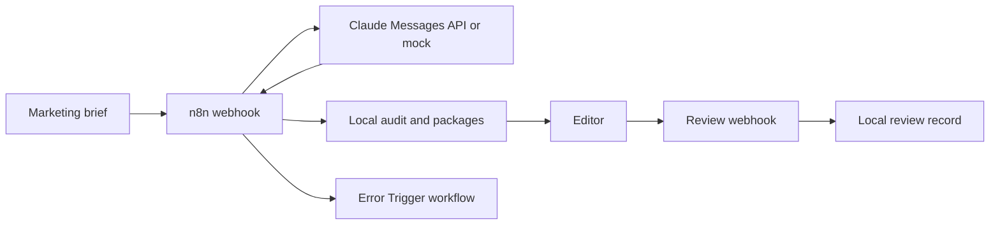

# Marketing Brief Automation

A personal portfolio project for an AI Automation Specialist role in marketing and web.

## Problem

A marketer with a short brief still needs an SEO title, meta description, article outline, LinkedIn draft and keywords. Drafting those pieces can take an estimated 20–30 minutes manually. That estimate is an assumption, and no business impact was measured.

## Solution

An authenticated n8n webhook turns an English or German brief into a content package. Claude generates the draft through the Anthropic Messages API. n8n validates it, makes one corrective request when needed and records an editorial decision through a second webhook. The bundled mock exercises the same workflow without an Anthropic account.

## Architecture



The [detailed diagram](docs/diagram.md) includes retries and the error branches. Compose starts the mock, imports both n8n workflows and publishes the workflow that owns the two webhooks. The separate Error Trigger workflow is called by n8n through the generation workflow's error setting.

## How it works

1. Send a JSON brief to `POST /webhook/marketing-brief` with `X-API-KEY`.
2. n8n trims the text fields and validates `topic` (5–200 characters), `audience` (1–200), optional `tone` (1–80), and optional `language` (`en` by default, or `de`). Length limits count Unicode code points.
3. The HTTP Request node sends the brief as data alongside a system prompt that specifies the output schema, requested language and factual constraints.
4. n8n parses the result and validates the exact fields and length limits. If needed, it sends a second generation request with the validation errors.
5. n8n writes a terminal audit row for the generation request. A completed generation also writes an artifact under `data/packages/` with editorial review pending.
6. An editor reads the package and checks claims, tone and brand fit. The editor sends `approve` or `request_changes` to `POST /webhook/marketing-brief-review` using the same key. The first decision is stored in `data/reviews/<run_id>.json`. For a failed draft, record `request_changes` and submit a revised brief for a new run.

## Error handling & safety

| HTTP | Status | Meaning |
| --- | --- | --- |
| 200 | `approved` | The package passed automated checks and is ready for editorial review. |
| 200 | `needs_review` | Both drafts failed validation. The response carries a null package. The second candidate is retained locally for inspection. |
| 400 | `rejected` | The brief failed input validation. |
| 401 | `rejected` | The API key was absent or invalid. |
| 502 | `error` | The provider call failed after three total HTTP attempts. |

Each HTTP Request node waits one second between failed attempts. This transport retry applies independently to the initial and corrective requests. On exhaustion, n8n logs the outcome, sends the safe 502 response, then signals a failed execution so the Error Trigger writes a separate diagnostic to `data/errors.jsonl`. Unexpected workflow errors also go to the Error Trigger when n8n can dispatch it.

`data/runs.jsonl` contains timestamps, run IDs, input lengths and language, status, checks, generation attempts and elapsed milliseconds. Generation attempts count initial and corrective requests, while HTTP retry attempts are observable separately in mock logs. Audit files exclude keys, raw provider errors and full request text. n8n retains failed execution data for debugging, so restrict access to the n8n UI and state volume.

## How to run

Requires a running Docker engine with Docker Compose, plus `curl` and `jq` for tests.

```sh
cd ~/marketing-brief-automation
cp .env.example .env
mkdir -p data
docker compose up -d --wait
```

n8n is available at <http://localhost:5678>. The editor may show first-time owner setup. The published webhooks work independently of editor login. Use `docker compose down` to stop the stack while retaining its data. After editing an exported workflow, run `docker compose restart n8n` to reimport and publish it. If the host runs Docker directly on Linux, make `data/` writable by container UID 1000 before startup.

For live generation, set `MOCK_LLM=false` and `ANTHROPIC_API_KEY` in `.env`, then run `docker compose up -d --wait` again. The requested default is the dated API ID `claude-sonnet-4-5-20250929`. Anthropic lists November 30, 2026 as its retirement date and `claude-sonnet-5-5` as its replacement. Set `CLAUDE_MODEL=claude-sonnet-5-5` to use the replacement. See [Anthropic's deprecation schedule](https://platform.claude.com/docs/en/about-claude/model-deprecations).

## How to test

```sh
./scripts/test.sh
```

With `MOCK_LLM=true`, the suite checks a valid brief, missing key, missing audience, invalid model JSON, an HTTP 500 outage, German output, human review and saved files. It counts actual mock requests to verify both retry paths. The tests append audit records and leave the generated test artifacts in `data/`.

## Example request/response

Load the webhook key from `.env` before making the example requests.

```sh
WEBHOOK_API_KEY=$(sed -n 's/^WEBHOOK_API_KEY=//p' .env | head -n 1)
curl -sS http://localhost:5678/webhook/marketing-brief \
  -H 'Content-Type: application/json' \
  -H "X-API-KEY: $WEBHOOK_API_KEY" \
  -d '{"topic":"Plan a spring campaign","audience":"Small business owners","tone":"practical"}'
```

Example mock response:

```json
{
  "run_id": "1",
  "status": "approved",
  "package": {
    "seo_title": "A practical guide for your next campaign",
    "meta_description": "Plan a focused campaign with clear audience goals, a content outline and a review checklist.",
    "outline": ["Define the audience", "Set a campaign goal", "Choose channels", "Draft the message", "Review before launch"],
    "linkedin_post": "Planning a new campaign? Start with your audience, pick one clear goal and give the draft an editorial review before launch.",
    "keywords": ["campaign planning", "audience research", "content outline", "marketing goals", "editorial review"]
  },
  "checks": [
    {"stage":"authentication","passed":true},
    {"stage":"input","passed":true,"errors":[]},
    {"stage":"output","attempt":1,"passed":true,"errors":[]}
  ],
  "message": "Automated checks passed. Editorial review is pending."
}
```

After reviewing the draft, replace `1` with its actual run ID:

```sh
curl -sS http://localhost:5678/webhook/marketing-brief-review \
  -H 'Content-Type: application/json' \
  -H "X-API-KEY: $WEBHOOK_API_KEY" \
  -d '{"run_id":"1","decision":"approve","note":"Claims and brand tone reviewed."}'
```

## Limitations

- This is a local portfolio demo with a shared key and one trusted n8n instance. It uses internal task runners, Code-node access to environment variables and local file writes. The published port is bound to loopback.
- Checks enforce structure and size. The prompt requests language and factual discipline. Editorial review covers factual accuracy, language quality and brand fit.
- Mock output is deterministic per language. In live mode, briefs go to Anthropic. Runtime and costs depend on the provider and retries.
- Review and package records are local files. The review endpoint uses a shared key and records one decision per draft, without a per-reviewer identity. n8n can reject malformed HTTP bodies before the workflow starts, so those requests may be absent from the audit file.

## Next steps

Add reviewer accounts, alerting for repeat provider failures, and retention controls. For a shared deployment, use an external task runner, managed credentials and a durable audit store.
